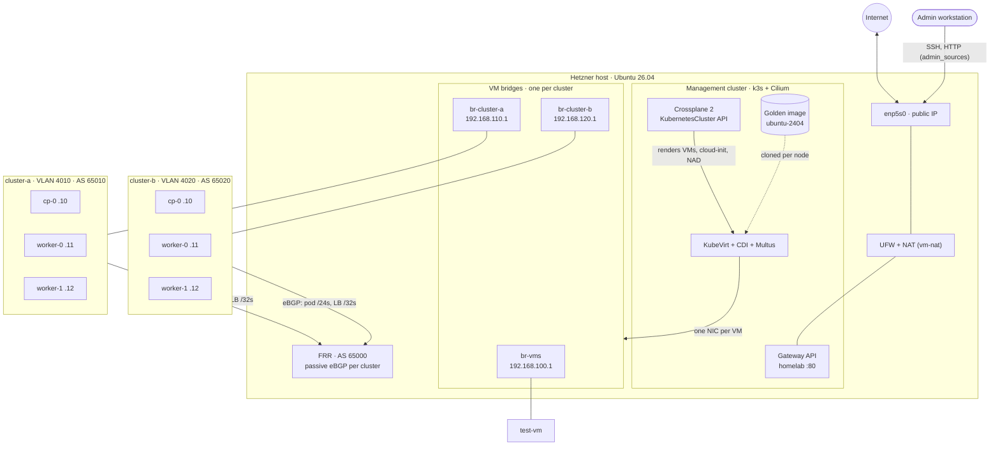
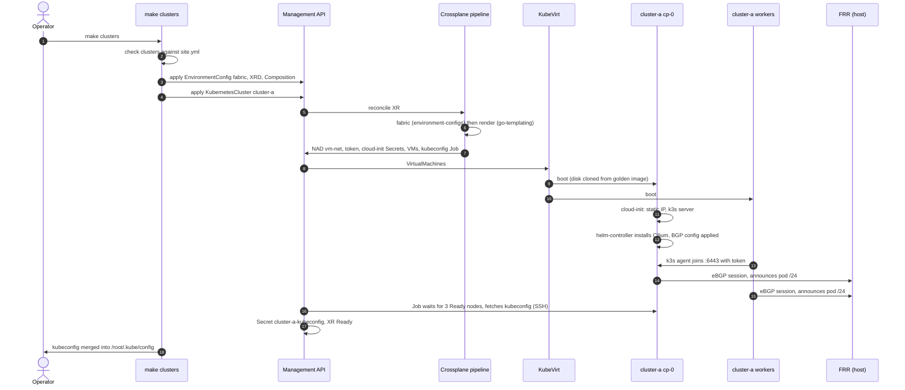
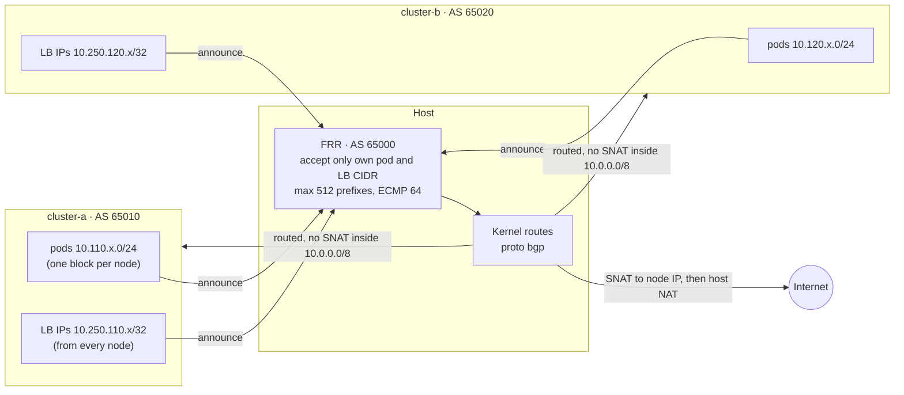

# kubevirt-infra

Code for a single-node **management cluster** that runs virtual machines with
KubeVirt and provisions **workload Kubernetes clusters** (k3s + Cilium) on those
VMs through a Crossplane API, one bridge per cluster. Workload clusters route
pods natively (no overlay) and announce pod CIDRs and LoadBalancer IPs over
BGP to the host, which plays the fabric.

```
                       Hetzner host (Ubuntu 26.04, enp5s0)
┌──────────────────────────────────────────────────────────────────────────────┐
│  k3s (embedded etcd) ─ Cilium CNI + kube-proxy replacement + Hubble          │
│   ├─ Gateway API (Cilium, host network) ─ Gateway gateway/homelab on :80     │
│   ├─ Multus, KubeVirt + CDI ─ golden image vm-images/ubuntu-2404             │
│   └─ Crossplane 2 ─ KubernetesCluster API (crossplane/)                      │
│                                                                              │
│  FRR (AS 65000) ─ eBGP with every workload node, routes pods + LB IPs        │
│  VM bridges (MTU 1350 for clusters)                 NAT ──► internet         │
│   ├─ br-vms        192.168.100.0/24  test-vm                                 │
│   ├─ br-cluster-a  192.168.110.0/24  cluster-a: cp .10, wk .11-.12           │
│   │                VLAN 4010, AS 65010, pods 10.110.0.0/16, LB 10.250.110.0/24│
│   └─ br-cluster-b  192.168.120.0/24  cluster-b: cp .10, wk .11-.12           │
│                    VLAN 4020, AS 65020, pods 10.120.0.0/16, LB 10.250.120.0/24│
└──────────────────────────────────────────────────────────────────────────────┘
```

## Architecture

### Topology

The host owns the network: one bridge per workload cluster with its gateway
`.1`, FRR peering with every workload node, UFW and NAT. The management
cluster runs the VMs (KubeVirt) and the `KubernetesCluster` API (Crossplane);
workload clusters only see their own bridge.



### Provisioning a cluster



### Routing between clusters

No overlay: every pod block and LoadBalancer IP is a route on the host,
learned over BGP and filtered against `site.yml`. The host announces nothing;
nodes use it as their default gateway.



Details: [Workload clusters](#workload-clusters) and [Networking](#networking).

## Evolution

The platform was built in steps; each one is a commit (or more) and left the
code able to rebuild everything from scratch.

1. **Management cluster** (`366c209`). Single-node k3s with embedded etcd,
   Cilium as CNI and kube-proxy replacement, Hubble. Multus, KubeVirt and CDI
   run VMs from a golden image (`vm-images/ubuntu-2404`); the smoke-test VM
   sits on the host bridge `br-vms`, NATed to the internet. Crossplane 2 with
   its functions is installed for the API that follows. UFW: inbound only from
   `admin_sources`.
2. **Workload clusters as an API** (`c6b217a`). The namespaced
   `KubernetesCluster` XRD and its Composition turn one object into k3s +
   Cilium VMs: cloud-init per node, join token, kubeconfig Job, status. One
   VLAN per cluster on a VLAN-aware `br-vms` (110, 120) with a gateway
   `br-vms.<id>` per VLAN; clusters routed to each other by the host, blocked
   from the host and the management networks. LoadBalancer IPs came from a
   range of the node subnet, announced with Cilium L2 announcements (ARP).
3. **Kubeconfig merge and Gateway API** (`0eb288f`). All kubeconfigs merged
   into `/root/.kube/config` (`kubectx cluster-a`), rebuilt whenever k3s
   rewrites its own. Cilium Gateway API in host network mode on the
   management cluster (`Gateway gateway/homelab` on :80).
4. **Native routing and a BGP fabric** (`4aa27cb`). No more overlay in the
   workload clusters: pods are routed natively and every node announces its
   pod block and every LoadBalancer IP (/32, own `loadBalancerCIDR` outside the
   node subnet) to FRR on the host, which plays the fabric (AS 65000, inbound
   filters per cluster, ECMP, announces nothing). Pods keep their IP towards
   `10.0.0.0/8`, strict reverse-path filtering per VLAN, service CIDR
   `172.20.0.0/16` shared by all clusters. Failover measured and tuned (hold
   timer 9s, graceful restart 120s, drain label). Fabric values reach the
   Composition through the EnvironmentConfig `fabric`.
5. **Architecture diagrams** (`1c74003`). The Mermaid diagrams above.
6. **One bridge per cluster, multi-host ready.** Each cluster gets its own
   bridge `br-<name>` instead of a VLAN on the shared `br-vms`. `vlan_id`
   becomes the cluster's segment between hosts (Hetzner vSwitch IDs, 4010 and
   4020), carried by `<vm_uplink>.<vlan_id>` once a second host joins. MTU 1350
   on bridges, VMs and pods: a vSwitch carries 1400 and VXLAN over it would take
   50 more. ASNs move to 65000 + 10 per cluster (65010, 65020). `make host`
   now cleans up what the previous layout left (files, links, firewall rules)
   and applies FRR changes with `frr-reload.py`.

Next: public ingress for tenant apps through HAProxy on the host, with Gateway
API removed from the management cluster.

## Quick start

On the management host, as root:

```bash
apt-get install -y make ansible     # or: make deps (needs make)
make all                            # host + k3s + platform
make test-vm                        # smoke test: clone, boot, static IP, SSH, internet
make test-vm-delete
make clusters                       # workload clusters from clusters/*/cluster.yaml
make network-test                   # allowed + blocked network paths
make status
```

`make help` lists every target. All playbooks are idempotent; re-running a
target converges the host back to the code.

| Target | What it does |
|---|---|
| `host` | Package upgrades, sysctls, CNI plugins, VM bridges (`br-vms`, `br-<cluster>`), NAT (`vm-nat.service`), BGP fabric (FRR), UFW rules, helm/virtctl, host SSH key for VMs |
| `k3s` | k3s with `ansible/templates/k3s-config.yaml.j2` (no flannel, kube-proxy, traefik, servicelb), Gateway API CRDs and Cilium |
| `platform` | Multus, KubeVirt, CDI, VM network, golden image, Crossplane + functions + RBAC, Gateway |
| `vendor` | Re-download pinned upstream manifests into `platform/*/upstream` |
| `validate` | Render every kustomization without touching the cluster |
| `crossplane-api` | Apply the `KubernetesCluster` XRD + Composition only |
| `clusters` | Check clusters against `site.yml`, apply API + clusters (SSH keys injected), wait Ready |
| `kubeconfig CLUSTER=…` | Write `~/.kube/<cluster>.kubeconfig` |
| `network-test` | BGP sessions up; from each control plane: internet + other clusters (nodes, pods, LB IPs) reachable, host/management blocked; pod-to-pod across clusters without SNAT |
| `clusters-delete` | **Destructive.** Delete all workload clusters and their disks (`CONFIRM=yes`) |
| `k3s-uninstall` | **Destructive.** Removes k3s and every VM (`CONFIRM=yes`) |

## Layout

```
ansible/
  group_vars/all/versions.yml   pinned versions (single place to upgrade)
  group_vars/all/site.yml       host IP/interface, CIDRs, VM network, admin IPs
  playbooks/                    host, k3s, platform, vendor, test-vm, clusters, network-test
  templates/                    k3s config, FRR config, cloud-init user/network data, network check
platform/
  cilium/values.yaml            Helm values
  gateway-api/                  vendored Gateway API CRDs (standard channel)
  gateway/                      shared Gateway (HTTP :80)
  multus/                       vendored thick-plugin manifest + patches
  kubevirt/{operator,config}/   vendored operator + KubeVirt CR
  cdi/{operator,config}/        vendored operator + CDI CR
  vm-network/                   NetworkAttachmentDefinition for br-vms (test VM)
  images/                       golden image DataVolume + clone RBAC
  crossplane/                   Helm values, functions, RBAC
vms/test-vm/                    smoke-test VM
crossplane/                     KubernetesCluster XRD + Composition
clusters/<name>/                namespace + quota, KubernetesCluster
```

## Workload clusters

A cluster is one namespaced `KubernetesCluster` (`clusters/cluster-a/cluster.yaml`):

```yaml
apiVersion: platform.kubvirt-infra.io/v1alpha1
kind: KubernetesCluster
metadata: {name: cluster-a, namespace: cluster-a}
spec:
  running: true                     # false: stop the VMs, keep the disks
  network:
    vlanId: 4010                    # segment between hosts (vSwitch VLAN)
    subnet: 192.168.110.0/24        # host is .1; nodes from nodeIPStart (10)
    asn: 65010                      # BGP AS of the cluster's nodes
    podCIDR: 10.110.0.0/16          # routed, announced per node
    loadBalancerCIDR: 10.250.110.0/24  # routed, announced as /32s
    serviceCIDR: 172.20.0.0/16      # default; never leaves the cluster
  cilium: {clusterId: 1}            # unique per cluster (Cluster Mesh-ready)
  controlPlane: {replicas: 1, cpu: 2, memory: 4Gi, diskSize: 20Gi}
  workers: {replicas: 2, cpu: 4, memory: 8Gi, diskSize: 40Gi}
```

`kubectl get kubernetescluster -A` shows phase, API endpoint and nodes.
`make clusters` writes each kubeconfig to `/root/.kube/<name>.kubeconfig` and
merges them with the management cluster's into `/root/.kube/config` (login
shells' `KUBECONFIG`), so `kubectx cluster-a` / `kubectl --context cluster-a`
work; the management context is `default`. `kubeconfig-merge.path` rebuilds the
file when k3s rewrites `/etc/rancher/k3s/k3s.yaml`. The
composition (`crossplane/composition.yaml`, function-go-templating) creates, in
the cluster's namespace:

* `vm-net`: bridge CNI on the cluster's bridge `br-<name>`, MTU and MAC spoof check.
* the k3s join token (generated once) and a cloud-init Secret per node: static
  IP/MAC derived from the subnet, MTU from the fabric, k3s server or agent.
* one `VirtualMachine` per node, disk cloned from the golden image, single NIC
  on `vm-net` (the guest is not on the pod network).
* a Job that waits until all nodes are Ready, then stores the kubeconfig in
  `<name>-kubeconfig`. The XR is Ready once that Job completes.

Inside the VMs, k3s runs without flannel/kube-proxy/traefik/servicelb. k3s's
helm-controller installs Cilium at boot: kube-proxy replacement with Maglev,
native routing, BGP control plane, LB IPAM from `loadBalancerCIDR`, Hubble.
The fabric's AS, routed range and MTU come from the EnvironmentConfig
`fabric`, written by `make clusters` from `site.yml` (`fabric_asn`,
`fabric_routed_cidr`, `vm_mtu`) and read by function-environment-configs.

Validation (CEL in `crossplane/xrd.yaml`): /24 subnet, node IPs in the subnet,
CIDRs valid, `vlanId`/`subnet`/`asn`/CIDRs/`clusterId` immutable. `make clusters`
checks each cluster against the `vm_networks` entry of the same name and that
VLANs and cluster IDs are unique; `make host` checks names (at most 12
characters, the bridge `br-<name>` must fit Linux's 15), VLAN IDs
(`vm_vlan_id_range`), private ASNs and that no two ranges overlap. Scaling
`workers.replicas` (0-8) is supported.

**Adding a cluster:** add its entry to `vm_networks` in `site.yml` (name,
VLAN, subnet, ASN, pod and LB CIDRs; conventions in the file), `make host`, add
`clusters/<name>/{namespace,cluster}.yaml` with the same values, `make clusters`.

## Exposing apps (Gateway API)

Cilium implements Gateway API in **host network mode**: Envoy listens on the
host's port 80 for `Gateway gateway/homelab`, so UFW applies (only
`admin_sources` can connect; VMs cannot). An app is exposed with an
`HTTPRoute` in its own namespace:

```yaml
apiVersion: gateway.networking.k8s.io/v1
kind: HTTPRoute
metadata: {name: my-app, namespace: my-app}
spec:
  parentRefs: [{name: homelab, namespace: gateway, sectionName: http}]
  hostnames: [my-app.homelab.local]
  rules: [{backendRefs: [{name: my-app, port: 8080}]}]
```

`*.homelab.local` is not in public DNS: add `<node_ip>  my-app.homelab.local`
to `/etc/hosts` on the workstation.

## Versions

Edit `ansible/group_vars/all/versions.yml`, then run `make vendor` (for Multus,
KubeVirt, CDI) and the matching target. Two pins live next to what they pin:
the Crossplane function packages (`platform/crossplane/functions.yaml`) and the
Ubuntu image build (`platform/images/ubuntu-2404.yaml`).

## Networking

* **Pods:** Cilium, `10.42.0.0/16`; services `10.43.0.0/16`.
* **VMs:** one NIC on their cluster's bridge (Multus secondary network,
  KubeVirt bridge binding), one bridge port per VM. The virt-launcher pod keeps
  its Cilium pod network; the VM does not use it. Addresses are static, set by
  cloud-init from the VM's fixed MAC.
* **Bridges:** one per workload cluster, `br-<name>`, with the gateway on `.1`
  (`vm_networks` in `site.yml`); `br-vms` (`192.168.100.0/24`) is the test VM's.
  Cluster bridges, VMs and so pods use MTU `vm_mtu` (1350).
* **Multiple hosts:** each cluster's `vlan_id` is its segment between hosts.
  With `vm_uplink` set (e.g. the Hetzner vSwitch NIC), `<vm_uplink>.<vlan_id>`
  joins `br-<name>` on every host. Hetzner vSwitch IDs are 4000-4091 and carry
  1400 bytes; 1350 leaves room for VXLAN (50 bytes) if the clusters move to one
  VNI each over a single vSwitch, without touching the VMs.
* **BGP fabric:** FRR on the host (AS `fabric_asn`, `ansible/templates/frr.conf.j2`)
  has one passive peer group per cluster (`bgp listen range` = the cluster's
  subnet, `remote-as` = the cluster's ASN: private, 65000 + 10 per cluster). Every node opens a session to its
  default gateway (Cilium `autoDiscovery: DefaultGateway`) and announces its pod
  block plus every LoadBalancer IP as a /32 (`externalTrafficPolicy: Cluster`,
  so all nodes do; the host spreads flows over them with ECMP, 5-tuple hash).
  Inbound filter: only the cluster's `pod_cidr` and `lb_cidr` from `site.yml`,
  max 512 prefixes per node; the host announces nothing (nodes use their
  default route). `vtysh -c 'show bgp summary'`, `ip route show proto bgp`.
* **Failover** (measured with a client opening ~10 connections/s to an LB IP):

  | Event | Routes | Effect |
  |---|---|---|
  | node dies or hangs | withdrawn when the 9s hold timer expires (keepalive 3s; Cilium OSS has no BFD) | new connections hashed to that node fail for ~8s |
  | Cilium agent restart (upgrade, config change) | kept by graceful restart (120s; the agent took 30-56s) | none |
  | planned maintenance: `kubectl label node <n> bgp.kubvirt-infra.io/drain=true` | withdrawn at once | none; remove the label afterwards |

  FRR ignores graceful restart when the hold timer expires
  (`no bgp graceful-restart notification`), otherwise a dead node would keep
  its routes for 9s + 120s. A node shut down without draining closes its
  sessions cleanly and keeps its routes for up to 120s. Existing connections
  to a node that leaves the ECMP set are reset (flows are rehashed).
* **Native routing:** no VXLAN. Nodes of a cluster route pod blocks to each
  other on their bridge (`autoDirectNodeRoutes`); other clusters are reached
  through the host. Pods keep their IP towards `fabric_routed_cidr`
  (`10.0.0.0/8`: all clusters' pods and LB IPs) and are masqueraded to the node
  IP otherwise (internet, node IPs), then to the host IP by `vm-nat`.
* **Anti-spoofing:** strict reverse-path filtering on each `br-<name>`: a
  cluster can only send from its subnet and the prefixes its nodes announced.
* **Firewall (UFW):** inbound to the host only from `admin_sources`, plus BGP
  (179/tcp) from each cluster bridge to its gateway.

  | From | To | |
  |---|---|---|
  | VMs | internet | allowed, NAT via `enp5s0` |
  | VMs, pods | same cluster | allowed (bridged) |
  | cluster | other clusters: nodes, pods, LB IPs | allowed, routed without NAT |
  | VMs | host services, management pods/services | **blocked** (explicit deny first) |
  | management pods | VMs, workload pods, LB IPs | allowed |
* The host reaches VMs directly: `ssh -i /root/.ssh/vm_ed25519 ubuntu@<vm-ip>`.
  From a workstation: `ssh -J root@<host> ubuntu@<vm-ip>`.

## Security notes

* Nothing secret is committed. Kubeconfigs, private keys and cloud-init secrets
  are generated on the host (see `.gitignore`).
* Expose HTTP apps through the Gateway (above), not Services.
* Cilium's kube-proxy replacement handles NodePort/LoadBalancer traffic in eBPF
  **before UFW sees it**. Do not create NodePort or LoadBalancer services on the
  management cluster unless they are meant to be public.
* k3s's API (6443) is not opened in UFW; add it to `admin_tcp_ports` to use
  kubectl from a workstation.

## Gotchas encoded here

* With `flannel-backend: none`, k3s's containerd uses the standard CNI paths
  (`/etc/cni/net.d`, `/opt/cni/bin`), so the upstream CNI plugins are installed
  there for Multus' `bridge` delegate.
* `kubernetes.core.helm` does not support Helm 4 yet; playbooks call
  `helm upgrade --install` directly.
* `systemctl reload frr` (FRR 10.5) restarts watchfrr, which systemd takes for
  a stop: the service ends up stopped. Configuration changes are applied with
  `frr-reload.py --reload` instead, which keeps the BGP sessions.
* networkd neither deletes netdevs whose file is gone nor changes options of an
  existing bridge: `make host` deletes the links of removed networks itself.
* `local-path` is `WaitForFirstConsumer`; the golden image requests immediate
  binding so it imports without a VM.

## Acknowledgements

Built with the help of [Claude Code](https://claude.com/claude-code).
